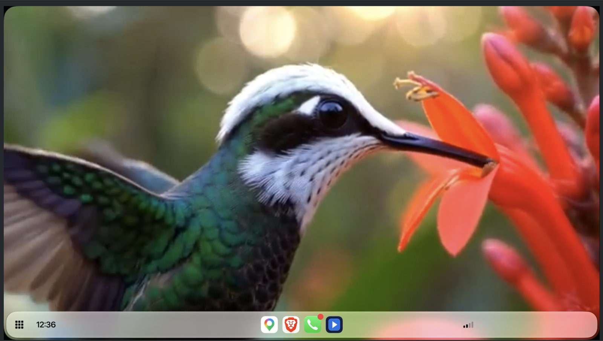
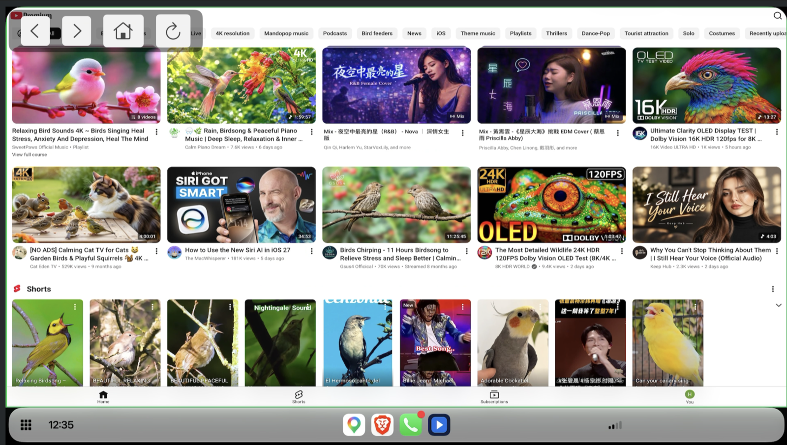
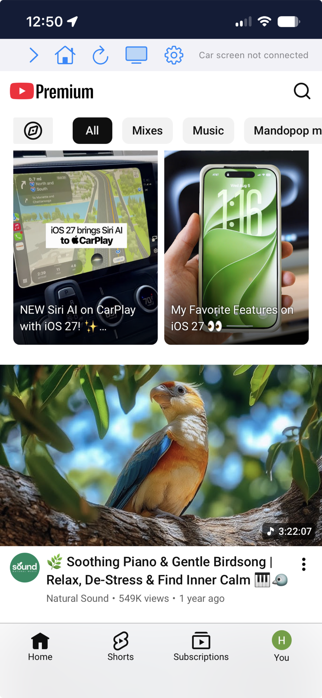

# Cafari Lite

The small, open part of [Cafari](https://github.com/rPlayAI/cafari-public): a web view on the CarPlay screen, pointed at YouTube's mobile site, and nothing else. An app delegate, two scene delegates and one view controller.

The full app also casts to Chromecast and AirPlay receivers, and its sideload builds live in that repository.

## What it looks like

The car screen, playing a video handed over from the phone:



Browsing on the car screen, with the floating controls top left and the debug
border switched on, which is the green outline showing exactly what area the
page is given:



The phone window, which is where you sign in and search, since CarPlay offers
a web view no keyboard. The status line on the right says whether a car screen
is connected:



## Read this before building

**The car screen needs an entitlement Apple grants, per developer account, on
request.** It is `com.apple.developer.carplay-video`. Without it iOS never
creates the car scene, and this app is a web browser on the phone and nothing
more. A free Apple ID cannot hold the entitlement, and a paid account does not
get it automatically: you ask Apple for it at
<https://developer.apple.com/contact/carplay/> and they decide.

So the entitlement is **not enabled in the checked-in project**. A clone builds
and runs for anyone, phone-only. If Apple has granted it to your account, see
"Turning the car screen on" below.

## How it works

Two scenes. The phone's window is the ordinary one. The car's is a plain
`UIWindowScene` under the role `UIWindowSceneSessionRoleCarPlay`, declared in
`Info.plist`. Because it is a window scene rather than a CarPlay template
scene, anything UIKit can draw appears on the head unit and takes touches from
it, a web view included.

The one non-obvious line: **UIKit does not expose that role in Swift.** There
is no member for it on `UISceneSession.Role`, so the code builds it from the
raw string, the same string the scene manifest uses:

```swift
let cafariLiteCarPlayRole = UISceneSession.Role(rawValue: "UIWindowSceneSessionRoleCarPlay")
```

Each window gets its own `WKWebView`. A web view lives in one window at a
time, so sharing one between the phone and the car means it disappears from
whichever screen it just left.

## Build and install, from the command line

No Xcode UI needed. Xcode itself has to be installed, for the toolchain and
the SDK, but nothing here opens it.

```sh
git clone https://github.com/rPlayAI/cafari-lite.git
cd cafari-lite
cp Local.xcconfig.example Local.xcconfig     # then edit it, see below
tools/run-on-device.sh                       # builds, signs, installs
```

`run-on-device.sh` picks the first attached, unlocked iPhone. With more than
one connected, name it:

```sh
xcrun devicectl list devices                 # copy the identifier
DEVICE=<identifier> tools/run-on-device.sh
```

Values can come from the environment instead of the file, which is what CI
would do:

```sh
BUNDLE_ID=com.you.cafarilite TEAM=ABCDE12345 tools/run-on-device.sh
```

The script prints which CarPlay entitlements ended up in the signed app, so
you can see at a glance whether this build can reach the car screen.

### The three settings

Signing is read from `Signing.xcconfig`, whose last line includes
`Local.xcconfig` if it exists. That file is git-ignored, so your team and
bundle id never show up in `git status` and never land in a pull request.

| Setting | What it is |
| --- | --- |
| `CAFARI_LITE_BUNDLE_ID` | Your own bundle identifier |
| `CAFARI_LITE_TEAM` | Your ten-character Apple Developer team |
| `CAFARI_LITE_ENTITLEMENTS` | Empty, or `CarPlay.entitlements` (see below) |

### In Xcode instead

`open CafariLite.xcodeproj` and run. It reads the same `Local.xcconfig`, so
the two routes agree.

CarPlay cannot be tested in the Simulator: the entitlements cannot be embedded
in a Simulator build, so there is nothing to test there.

## Turning the car screen on

Only once Apple has granted your account **both** CarPlay entitlements, video
and audio. Video alone is not enough: the app builds, installs and runs on the
phone, and simply never appears on the head unit, with no error anywhere.

Set `CAFARI_LITE_ENTITLEMENTS = CarPlay.entitlements` in your
`Local.xcconfig`, build again, and connect to CarPlay.

If the entitlements are missing the build fails to sign, which is the intended
failure: it is clearer than an app that installs and then shows nothing in the
car.

## Reading what happened

The app writes to `Documents/lite.log` inside its container: scene
connections, window and panel sizes, navigation, and the parked gate. Pull it
without a cable in the way:

```sh
xcrun devicectl device copy from --device <identifier> \
  --domain-type appDataContainer --domain-identifier <your bundle id> \
  --source Documents/lite.log --destination ./lite.log
```

## Limitations

- Playback is whatever the site does in a web view. No downloads, no
  background playback, no DRM-protected services.
- The head unit's own rules still apply. Some cars restrict what is shown
  while the vehicle is moving.
- Apple can withdraw or change this scene role in any iOS release. Treat the
  car screen as something that works today rather than something guaranteed.

## Licence

MIT, see LICENSE. Not affiliated with, endorsed by, or connected to Apple or
YouTube. CarPlay is a trademark of Apple Inc.
